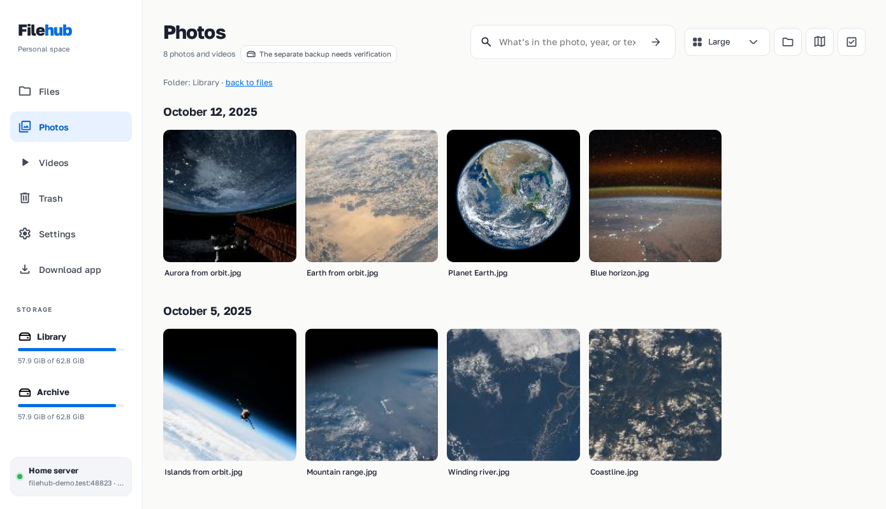
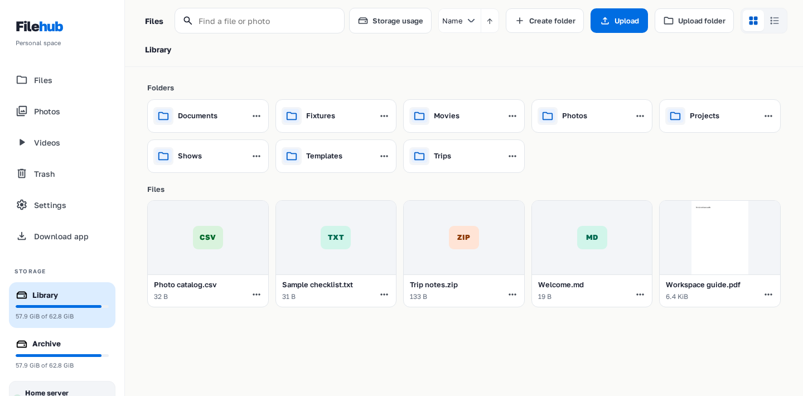
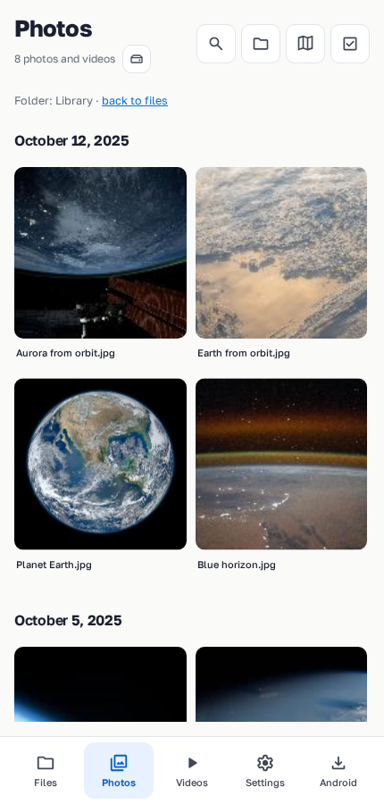
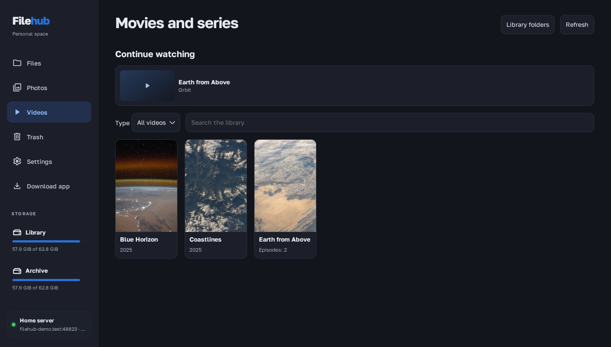
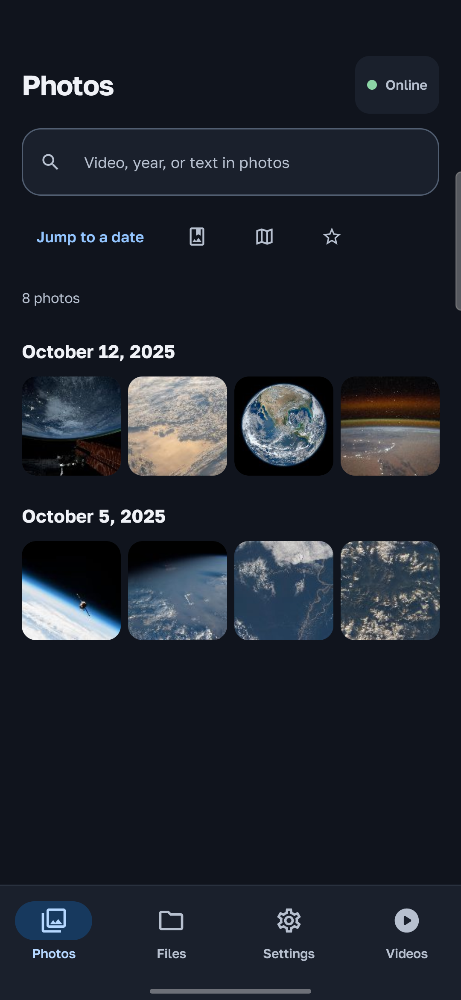
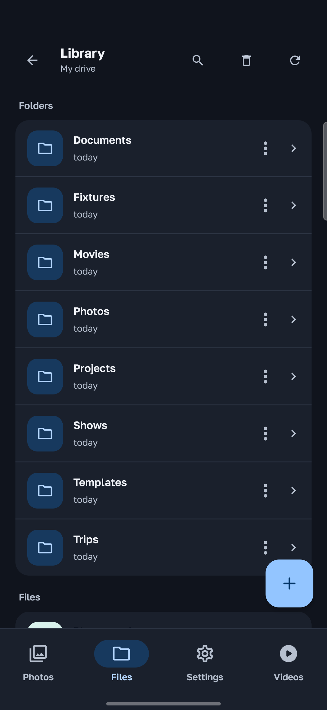
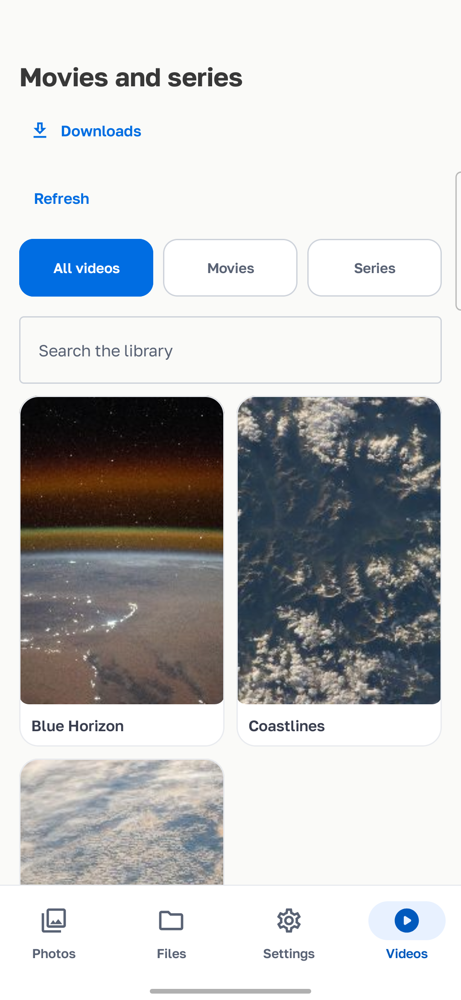
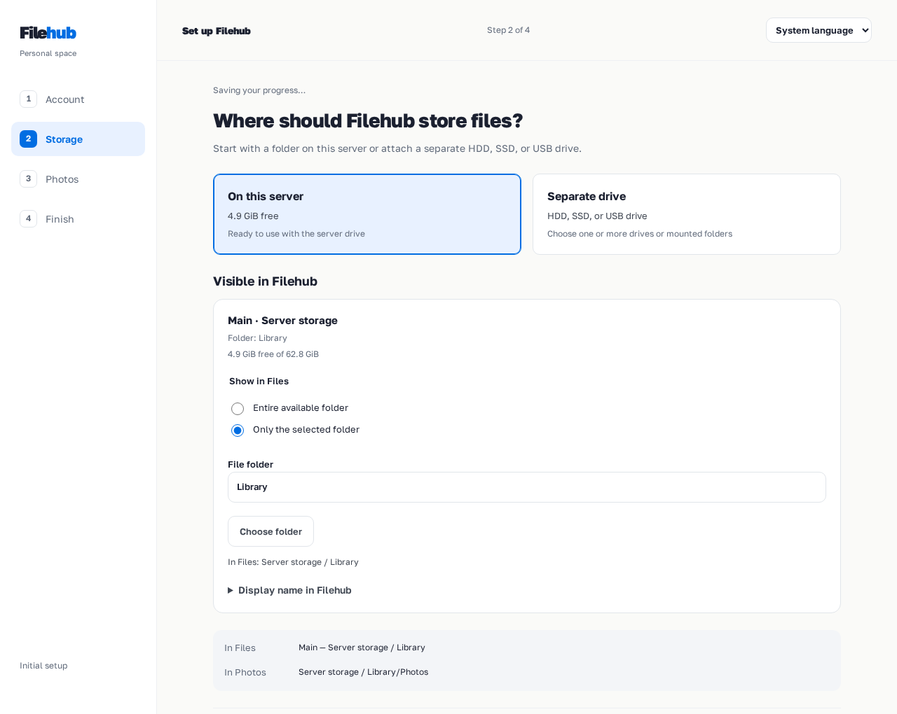

<p align="center"></p>

<p align="center"><a href="README.ru.md">Русский</a></p>

**Browse your existing files, photos and videos from a browser on your computer
or phone.** FileHub uses the folders on your server. The Android app can resume
interrupted photo uploads and check the server copy before offering to free up
space on your phone.

[Install FileHub](#install-filehub) · [60-second overview](#demo) · [Android screenshots](docs/android-screenshots.md)

## Install FileHub

**1.40.22** · [Linux x86-64 installer](https://github.com/Pique1804/filehub/releases/download/v1.40.22/filehub-1.40.22-linux-amd64-installer.tar.gz) · [SHA-256](https://github.com/Pique1804/filehub/releases/download/v1.40.22/filehub-1.40.22-linux-amd64-installer.tar.gz.sha256) · [Android APK](https://github.com/Pique1804/filehub/releases/download/v1.40.22/filehub-1.40.22.apk) · [Release notes](https://github.com/Pique1804/filehub/releases/tag/v1.40.22)

Already have the Android app? Open **Settings → App → Check for updates**.

On Debian 12 x86-64 with systemd, run the command below. On a minimal installation, install the `curl` package first.

```sh
curl -fsSL https://github.com/Pique1804/filehub/releases/latest/download/install.sh | bash
```

The installer checks the archive's SHA-256 and prints a private link to the
setup wizard. Open it to create your account and choose your folders.

[Linux and Proxmox guide](docs/installation.en.md) · [Upgrade an existing server](docs/upgrading.md)

## System requirements

| Platform | What you can use |
| --- | --- |
| Linux server | Debian 12 x86-64 with systemd is the tested install path for 1.40.22. The installer also targets Ubuntu 24.04 x86-64. |
| Proxmox LXC | Run FileHub in a container and [connect physical drives from the Proxmox host](docs/installation.en.md#connect-a-physical-disk-in-proxmox-lxc). |
| Docker Compose | The [Compose guide](docs/compose.md) uses 1.40.22. Compose acceptance was completed with 1.40.20. |
| Windows, macOS and Linux computers | Open files, photos and videos in your browser, or connect to files over WebDAV. |
| Android 8.0 or newer | Use the signed APK for photo backup and offline files and episodes. |
| iPhone and iPad | Open your FileHub address in Safari to browse photos and access files. |

**Android background photo backup requires trusted HTTPS.** In a trusted home
network you can browse and upload files manually over HTTP.

For a small library, start with **2 CPU cores, 2 GB RAM and 8–12 GB for the OS
and application**. Allow additional space for originals, previews and the index.
[Resource estimates and test results](docs/resources.md).

## Demo

https://github.com/user-attachments/assets/86f9269d-ee0c-4be7-bf5a-5f59196b4cb7

[Download the 60-second overview (MP4)](https://github.com/Pique1804/filehub/releases/download/v1.40.22/FileHub-overview-EN-60s.mp4) · [Image credits](docs/screenshot-credits.md)

Explore files, search, photos, video and sharing. At 0:35, see how new
photos from selected Android albums upload automatically to your FileHub server.

### Personal folders and photos

See how an administrator creates a profile and chooses which folders it can open.
Alex and Blair each get a personal folder and a photo gallery. Both can read the
same shared guides. The demo uses two test accounts on one server (31 seconds).

https://github.com/user-attachments/assets/c352cf9d-eb0d-4d55-8a9e-4f46af4873c7

<details>
<summary>Android upload and verification demo (15 seconds)</summary>

https://github.com/user-attachments/assets/39154ed0-cae6-4b7c-a9e6-ac2b9152f9ac

[Download the MP4](https://github.com/Pique1804/filehub/raw/refs/heads/main/docs/media/android-backup-demo.mp4)

The demo illustrates a tested Android backup with sample data. It shows the
upload resuming after an interruption and compares the downloaded file with the
original.

</details>

## Where your files stay

FileHub indexes existing files in the server folders you select. Albums refer
to the original photos in those folders. The map requests its base tiles from
OpenStreetMap by default. If you enable TMDB for posters, FileHub sends the title
and year of the film or series. [Map tiles and posters](docs/maps-and-media.md).

[FAQ](docs/faq.md) · [Storage](docs/storage.md) · [Changelog](CHANGELOG.md)

<picture>
  <source media="(prefers-color-scheme: dark)" srcset="docs/images/photos-dark.png">
  <source media="(prefers-color-scheme: light)" srcset="docs/images/photos-light.png">
  
</picture>

*Real Filehub screens with a sample photo library. [Image credits](docs/screenshot-credits.md).*

## What you can do

- **Files.** Browse folders, recent files and search results in a sortable list or
  a preview grid. Create folders, upload files or folders, rename, copy, move and
  download. Use drag and drop or the clipboard in a supported desktop browser.
  Pause and resume uploads, preview supported images, videos, PDFs and Office
  documents, and restore or permanently delete selected items in the trash.
  Office previews require LibreOffice.
- **Search.** Find files by part of their name with a trigram index. Filter by
  extension, type, storage, size or modification date. OCR finds text in indexed
  screenshots and photos. Searching for what a picture shows requires the
  [optional local visual search model](server/clip-sidecar/README.md) and image
  indexing.
- **Photos.** Browse the timeline, albums, stories and a map with clustered
  locations and date filters. Adjust thumbnail size on desktop. Select several
  photos to download, move, add to an album or send to the trash. The timeline
  uses folders chosen inside your existing storage.
- **Movies and series.** Group library folders into films, seasons and episodes.
  Resume playback in the browser or on Android. Play compatible videos directly
  or convert them on the server with FFmpeg. Local covers take priority.
  An administrator can configure TMDB for posters and descriptions and correct
  a title match.
- **Android.** Browse files and photos, share files to FileHub from other apps,
  and download files or episodes to the offline list with progress. Back up
  selected albums with resumable uploads. Check server receipts and SHA-256
  before removing verified local copies. The server provides signed APK downloads
  and updates. The app supports English, Russian and the device language.
- **Profiles and sharing.** Invite users, grant access to individual folders,
  and give profiles writable personal folders with quotas. See the owner of
  shared files where recorded, share files or albums by link, and connect
  desktop clients over WebDAV.
- **Storage and recovery.** Use regular folders or mounted disks, monitor space,
  and schedule backups of selected folders and the catalogue database to another
  storage location. [Storage and backup guides](docs/installation.md#резервное-копирование)

<table>
<tr>
<td width="72%"></td>
<td width="28%"></td>
</tr>
<tr><td>Web file manager</td><td>Mobile web</td></tr>
</table>



[Video library in a mobile browser](docs/images/videos-mobile.png)

## Native Android app

The native Android app supports English, Russian and the device language.
It checks for updates on your FileHub server when you open it. To check manually,
go to **Settings → App → Check for updates**. If a newer version is available,
tap **Update** and confirm installation when Android asks.

<table>
<tr>
<td width="33%"></td>
<td width="33%"></td>
<td width="33%"></td>
</tr>
<tr><td>Photos</td><td>Files</td><td>Video library</td></tr>
</table>

[Open the four Android screenshots individually](docs/android-screenshots.md) · [Feature guide and common questions](docs/faq.md)

## First-run setup

1. Install the Linux package and open the private setup link printed in the terminal.
2. Create your administrator account, with password confirmation.
3. Choose a server folder or select one or more connected disks. Expand each disk to choose folders for **Files**.
4. Choose an existing or empty photo folder, or select **Skip photos**. Start FileHub.
5. Open **Phone and storage** to download the Android APK and connect your phone.



The wizard keeps an unfinished setup on the server so you can return to the same
step. Installing Filehub inside a container does not automatically grant access
to physical host disks: the storage screen explains the host connection step.
On Proxmox LXC the helper runs on the host and exposes selected storage to the
container. [How storage works](docs/storage.md).

Add more disks or photo folders later in **Phone and storage → Storage**.

## Try an Android backup

After setting up the server, use **Download app** in the web sidebar.

1. Follow the [Linux installation guide](docs/installation.en.md) and select a folder for the test files.
2. Connect to FileHub over trusted HTTPS in the Android app. Select an album containing one test video, set the destination to that folder, and start backup.
3. Open the phone cleanup screen and check the fresh SHA‑256 verification result. You can leave the video on the phone.
4. Download the original from **Files** and compare its SHA‑256 with the input video. On Windows, use `Get-FileHash -Algorithm SHA256` for each file.

## Data and access

Set up roles and folder access as an administrator. The same permissions apply
in the web interface, Android and WebDAV. Use HTTPS or a private VPN for remote
access. Create a separate copy of originals and the database on another drive and
verify that it can be restored. Scheduled server backups can copy selected folders
to a separate storage location.

## Development

One repository contains the Go/Svelte server, Kotlin/Compose Android app and
Linux installer. Start with [development notes](docs/development.md) and
[contribution guidance](CONTRIBUTING.md). Use the [issue tracker](https://github.com/Pique1804/filehub/issues)
for product bugs and feature requests. Report security issues through [private security reporting](SECURITY.md).

## License

Filehub source is licensed under [MIT](LICENSE). Fonts, icons, dependencies and
sample photographs retain their own licenses; see [third-party notices](THIRD_PARTY_NOTICES.md).
