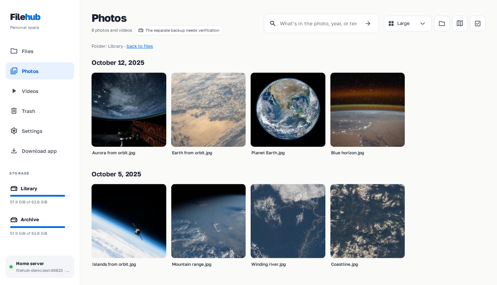
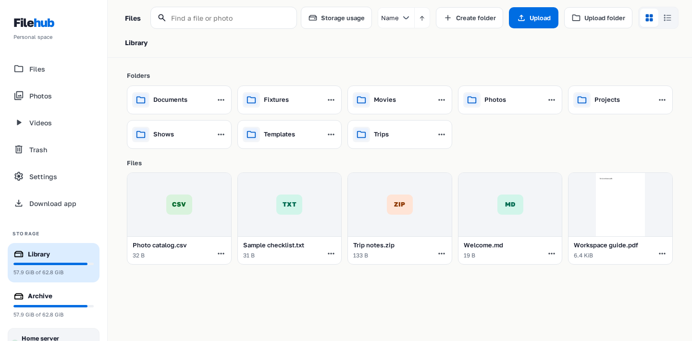
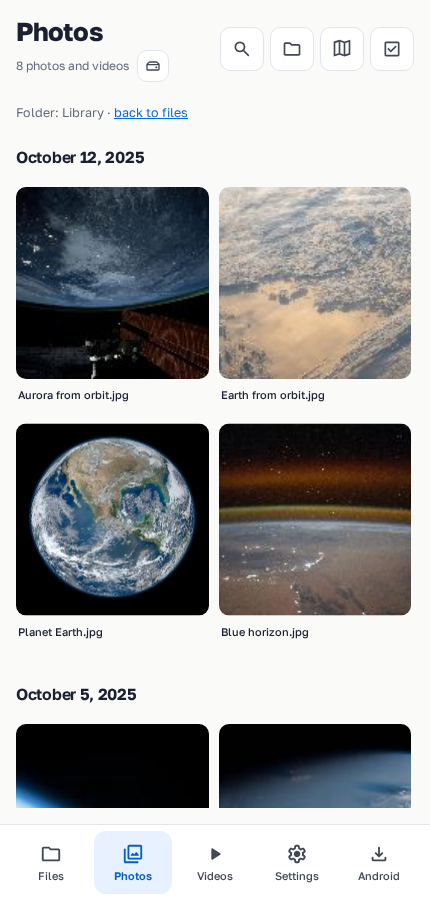
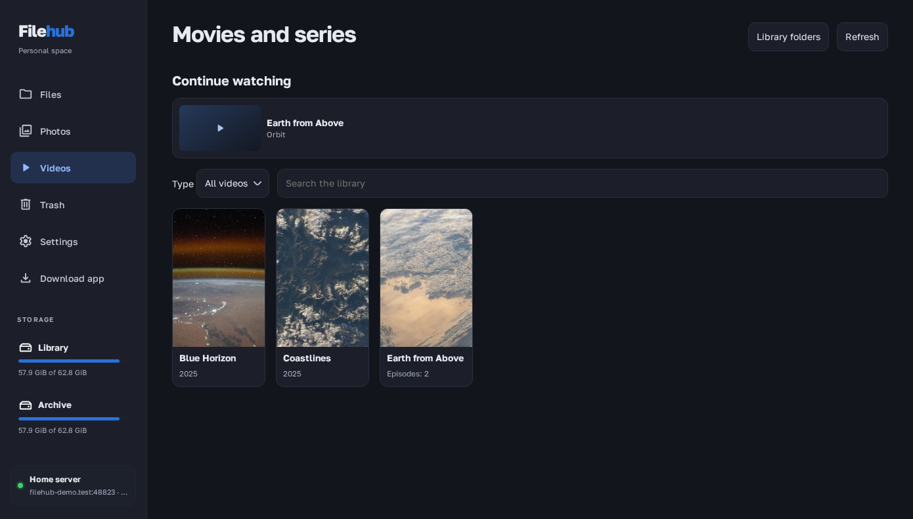
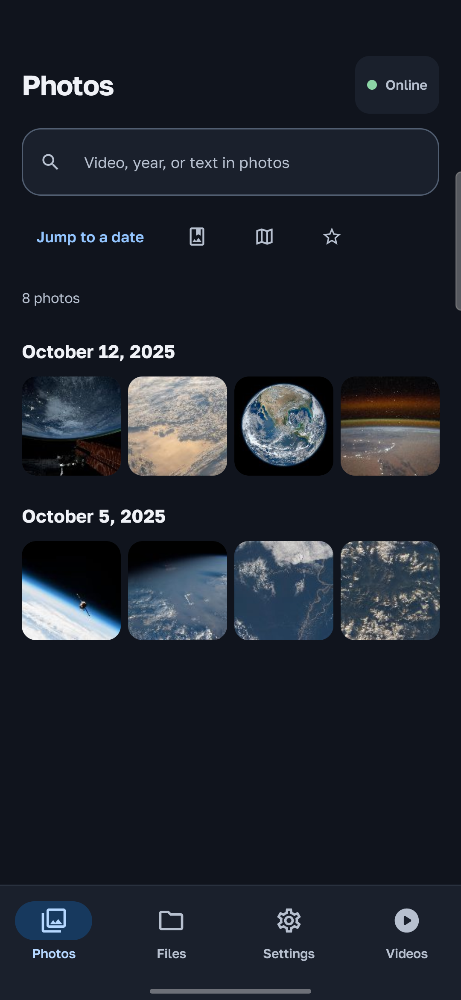
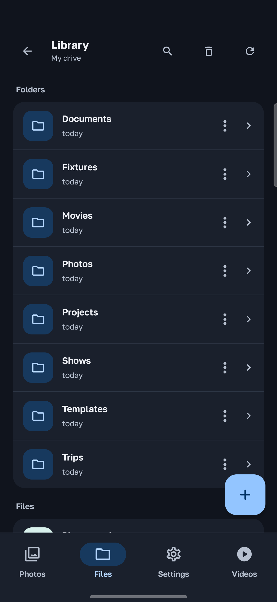
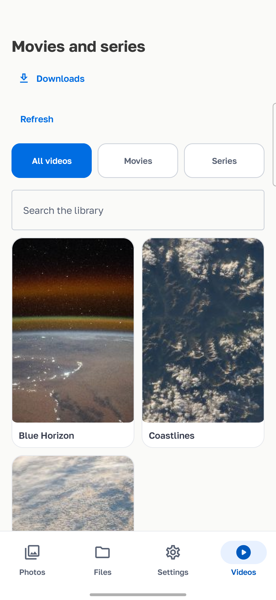
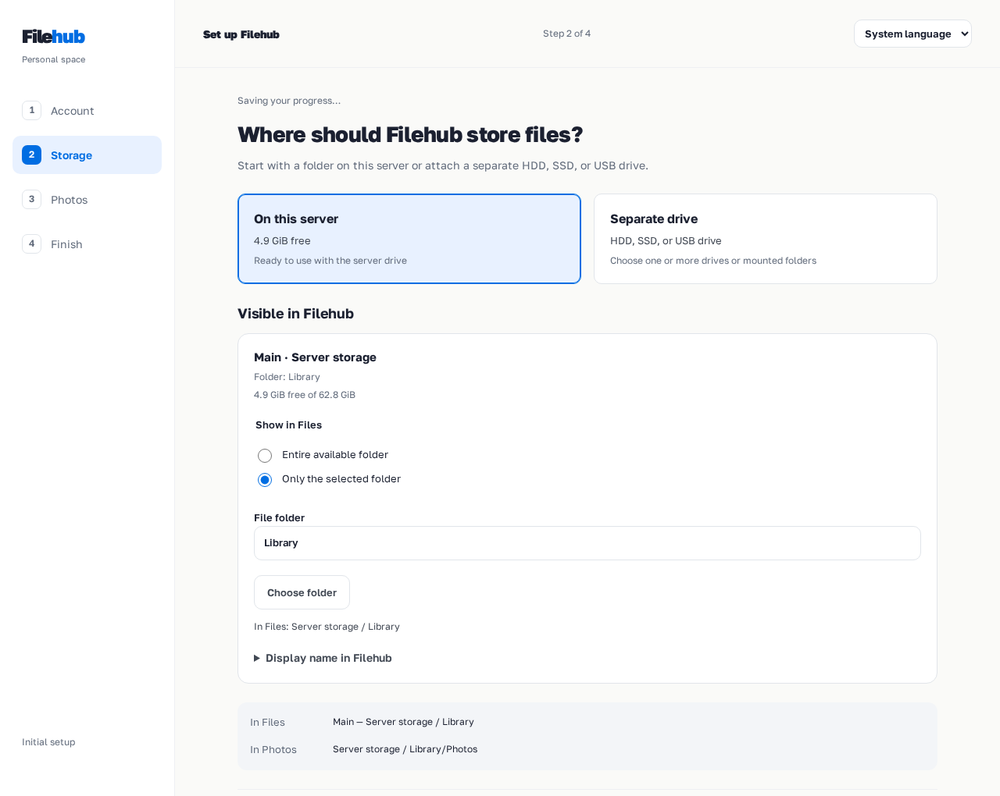

<p align="center"></p>

<p align="center"><a href="README.md">English</a></p>

**Открывайте файлы, фото и видео из папок вашего сервера в браузере на
компьютере или телефоне.** Android-приложение докачивает фото после обрыва
и сверяет копии на сервере, прежде чем предложить освободить место на телефоне.

[Установить FileHub](#установка-filehub) · [Минутный обзор](#демо) · [Скриншоты Android](docs/android-screenshots.md)

## Установка FileHub

**1.40.22** · [Установщик Linux x86-64](https://github.com/Pique1804/filehub/releases/download/v1.40.22/filehub-1.40.22-linux-amd64-installer.tar.gz) · [Контрольная сумма SHA-256](https://github.com/Pique1804/filehub/releases/download/v1.40.22/filehub-1.40.22-linux-amd64-installer.tar.gz.sha256) · [Android APK](https://github.com/Pique1804/filehub/releases/download/v1.40.22/filehub-1.40.22.apk) · [Описание выпуска](https://github.com/Pique1804/filehub/releases/tag/v1.40.22)

Если Android-приложение уже установлено, откройте **Настройки → Приложение → Проверить обновление**.

На Debian 12 x86‑64 с systemd выполните команду ниже. В минимальной установке сначала установите пакет `curl`.

```sh
curl -fsSL https://github.com/Pique1804/filehub/releases/latest/download/install.sh | bash
```

Установщик сверит SHA-256 архива и напечатает приватную ссылку на мастер.
Откройте её, чтобы создать аккаунт и выбрать папки.

[Инструкция Linux и Proxmox](docs/installation.md) · [Обновление сервера](docs/upgrading.md)

## Требования к серверу и клиентам

| Платформа | Что доступно |
| --- | --- |
| Сервер Linux | Установка 1.40.22 проверена на Debian 12 x86‑64 с systemd. Установщик рассчитан также на Ubuntu 24.04 x86‑64. |
| Proxmox LXC | FileHub работает в контейнере. [Физические диски подключаются через узел Proxmox](docs/installation.md#отдельный-диск-или-подключённая-папка). |
| Docker Compose | [Инструкция](docs/compose.md) использует пакет 1.40.22. Приёмка Compose пройдена с 1.40.20. |
| Windows, macOS и Linux | Файлы, фото и видео в браузере. Доступ к файлам по WebDAV. |
| Android 8.0 и новее | Подписанный APK, резервное копирование фото, файлы и серии офлайн. |
| iPhone и iPad | Откройте адрес своего FileHub в Safari для доступа к файлам и фотоленте. |

**Для фонового автобэкапа Android нужен доверенный HTTPS.** В доверенной
домашней сети можно открывать и загружать файлы вручную по HTTP.

Ориентир для небольшой библиотеки — **2 ядра, 2 ГБ RAM и 8–12 ГБ под ОС и приложение**.
Место для оригиналов, миниатюр и индекса учитывайте отдельно.
[Ресурсы и результаты проверок](docs/resources.md).

## Демо

https://github.com/user-attachments/assets/86f9269d-ee0c-4be7-bf5a-5f59196b4cb7

[Скачать минутный обзор на английском (MP4)](https://github.com/Pique1804/filehub/releases/download/v1.40.22/FileHub-overview-EN-60s.mp4) · [Источники изображений](docs/screenshot-credits.md)

Файлы, поиск, фото, видео и общий доступ. С 0:35 показано, как новые
фотографии из выбранных альбомов Android сами загружаются на сервер FileHub.

### Личные папки и фотографии

Администратор создаёт профиль и выбирает, какие папки ему доступны.
У Алекса и Блэр свои файлы и фотогалереи, а папку с общими инструкциями могут
читать оба. В ролике показаны два тестовых аккаунта на одном сервере (31 секунда).

https://github.com/user-attachments/assets/c352cf9d-eb0d-4d55-8a9e-4f46af4873c7

<details>
<summary>Докачка и сверка файлов на Android (15 секунд)</summary>

https://github.com/user-attachments/assets/39154ed0-cae6-4b7c-a9e6-ac2b9152f9ac

[Скачать MP4](https://github.com/Pique1804/filehub/raw/refs/heads/main/docs/media/android-backup-demo.mp4)

Демо иллюстрирует проверенный бэкап Android на тестовых данных. В нём видно,
как загрузка продолжается после обрыва и как скачанный файл сверяется с оригиналом.

</details>

## Где хранятся файлы

FileHub индексирует файлы в выбранных папках сервера. Альбомы ссылаются
на оригиналы в этих папках. Карта по умолчанию запрашивает подложку у
OpenStreetMap. При включении TMDB FileHub передаёт название и год фильма
или сериала, чтобы подобрать постер. [Карта и постеры](docs/maps-and-media.md).

[Частые вопросы](docs/faq.ru.md) · [Диски и папки](docs/storage.md) · [История изменений](CHANGELOG.md)

<picture>
<source media="(prefers-color-scheme: dark)" srcset="docs/images/photos-dark.png">

</picture>

*Работающий Filehub с отдельной библиотекой открытых снимков. Личных файлов на
скриншотах нет. [Источники изображений](docs/screenshot-credits.md).*

## Что умеет FileHub

- **Файлы.** Открывайте папки, недавние файлы и результаты поиска в сортируемом
  списке или плитках с превью. Создавайте папки, загружайте файлы и каталоги,
  переименовывайте, копируйте, перемещайте и скачивайте. Работают перетаскивание
  и буфер обмена в поддерживаемых браузерах компьютера. Загрузку можно
  приостановить и продолжить. Есть предпросмотр изображений, видео, PDF и
  поддерживаемых документов Office. Для Office нужен LibreOffice. В корзине
  можно восстановить или удалить насовсем выбранные файлы.
- **Поиск.** Триграммный индекс ищет по части имени. Есть фильтры по расширению,
  типу, хранилищу, размеру и дате изменения. OCR находит текст на изображениях
  и скриншотах. Поиск того, что изображено на фото, требует
  [отдельной локальной модели](server/clip-sidecar/README.md) и индексации.
- **Фото.** Лента, альбомы, истории и карта с группировкой снимков и выбором дат.
  На компьютере можно менять размер плиток. Несколько фото можно скачать,
  переместить, добавить в альбом или отправить в корзину. Для фотоленты
  используются выбранные папки внутри хранилищ.
- **Фильмы и сериалы.** Выбирайте папки медиатеки, открывайте фильмы, сезоны
  и серии, продолжайте просмотр с сохранённого места в вебе или на Android.
  Для несовместимого видео сервер может использовать FFmpeg. Локальные обложки
  имеют приоритет. Администратор может подключить TMDB и уточнить совпадение.
- **Android.** Просматривайте файлы и фото, отправляйте файлы из других
  приложений в FileHub и скачивайте файлы или серии для просмотра офлайн.
  В списке загрузок виден прогресс. Выбранные альбомы можно автоматически
  копировать с докачкой при обрыве. Перед очисткой телефона FileHub сверяет
  квитанцию сервера и SHA-256. APK и обновления скачиваются с вашего сервера.
  Можно выбрать русский, английский или язык устройства.
- **Профили и общий доступ.** Приглашайте пользователей, выдавайте доступ
  к отдельным папкам и задавайте квоты личным папкам. У общих файлов отображается
  владелец, если он известен. Есть ссылки на файлы и альбомы и подключение
  по WebDAV с компьютера.
- **Хранилища и восстановление.** Используйте обычные папки или подключённые
  диски, смотрите расход места и настраивайте копирование выбранных папок и
  базы на другой накопитель по расписанию. [Как настроить резервные копии](docs/installation.md#резервное-копирование)

<table>
<tr>
<td width="72%"></td>
<td width="28%"></td>
</tr>
<tr><td>Файловый менеджер</td><td>Веб на телефоне</td></tr>
</table>



[Медиатека в браузере телефона](docs/images/videos-mobile.png)

## Приложение Android

В приложении для Android можно выбрать русский, английский или системный язык.
При запуске приложение проверяет обновления на вашем сервере FileHub. Для ручной
проверки откройте **Настройки → Приложение → Проверить обновление**. Если доступна
новая версия, нажмите **Обновить** и подтвердите установку в Android.

<table>
<tr>
<td width="33%"></td>
<td width="33%"></td>
<td width="33%"></td>
</tr>
<tr><td>Фото</td><td>Файлы</td><td>Медиатека</td></tr>
</table>

[Открыть четыре скриншота приложения по отдельности](docs/android-screenshots.md) · [Возможности FileHub и ответы на частые вопросы](docs/faq.ru.md)

## Первая настройка

1. Откройте закрытую ссылку с кодом из терминала установки.
2. Создайте администратора и дважды введите новый пароль.
3. Выберите папку сервера или отметьте нужные диски галочками. Раскройте диск, чтобы выбрать папки для «Файлов».
4. Выберите существующую или пустую папку для фотоленты либо нажмите **Пропустить фото**.
5. После запуска скачайте APK со страницы «Телефон и хранилища».



Фото — это выбранные папки внутри источников файлов. Для них не нужен отдельный
обязательный диск. Если Filehub установлен в контейнер, физические диски сначала
нужно предоставить с хоста; мастер объясняет этот шаг. Незавершённая настройка
сохраняется на сервере. [Подробнее о дисках](docs/storage.md).

После запуска диски и папки для фото можно добавить в **Телефон и хранилища → Хранилища**.

## Попробуйте бэкап с Android

После настройки сервера нажмите «Скачать приложение» в боковом меню веба.

1. Установите сервер по [инструкции для Linux](docs/installation.md) и выберите папку для тестовых файлов.
2. Подключите Android-приложение к FileHub по доверенному HTTPS. Выберите альбом с одним тестовым видео, укажите папку назначения и запустите бэкап.
3. На экране очистки телефона посмотрите результат свежей сверки SHA‑256. Видео можно оставить на телефоне.
4. Скачайте оригинал из раздела «Файлы» и сравните его SHA‑256 с исходным видео. В Windows для обоих файлов подойдёт `Get-FileHash -Algorithm SHA256`.

## Доступ и резервные копии

Администратор настраивает роли и доступ к папкам. Права действуют в вебе,
Android и WebDAV. Для доступа извне используйте HTTPS или VPN. Храните
проверенную копию оригиналов и базы на отдельном накопителе. Для выбранных
папок можно включить резервное копирование по расписанию.

## Разработка и лицензия

Сервер Go/Svelte — в `server/`, Android Kotlin/Compose — в `android/`.
[Разработка](docs/development.md) · [Вклад в проект](CONTRIBUTING.md) ·
[Сообщить об ошибке или предложить улучшение](https://github.com/Pique1804/filehub/issues) ·
[Сообщить об уязвимости](SECURITY.md).

Код Filehub — [MIT](LICENSE). Шрифты, значки и фотографии сохраняют отдельные
лицензии: [уведомления](THIRD_PARTY_NOTICES.md).
