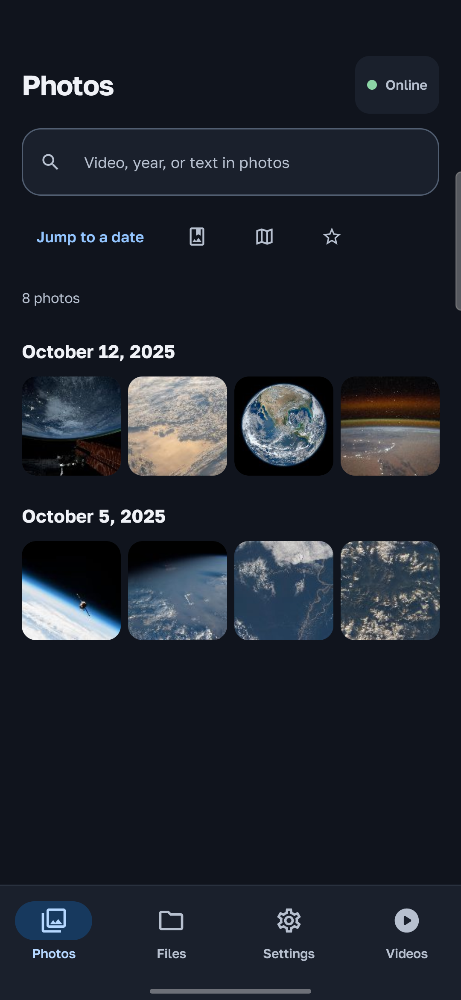
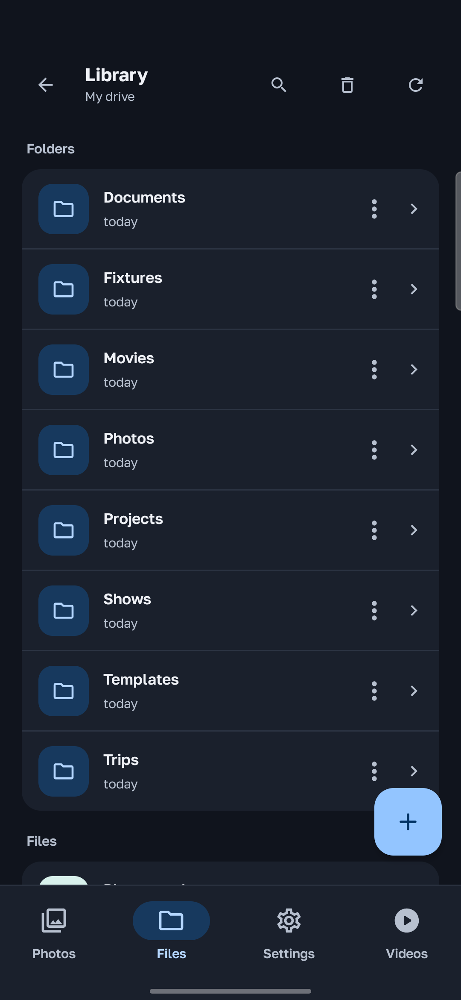
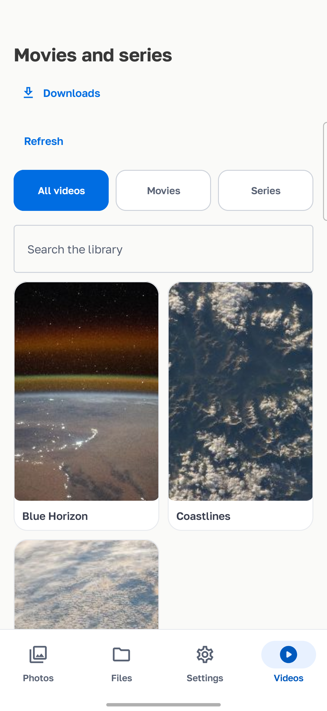
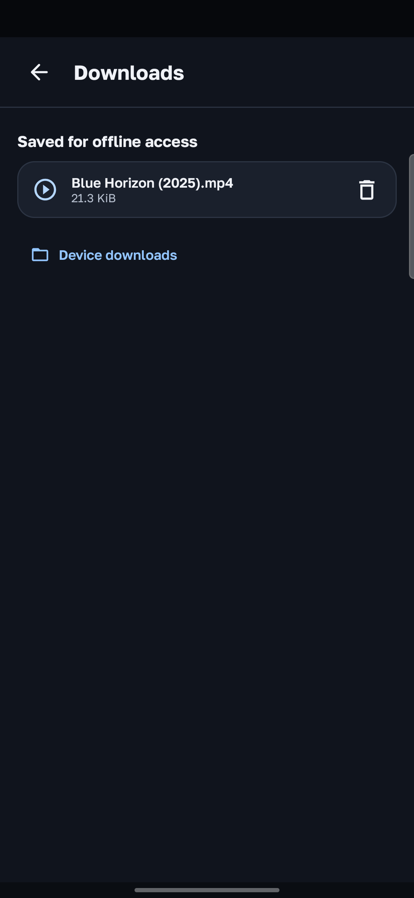

# FileHub на Android · FileHub on Android

Четыре скриншота Android-приложения на тестовых данных. Нажмите на изображение, чтобы открыть его в полном размере.

Four screenshots of the native Android app using sample data. Select an image to view it at full size.

[Фото · Photos](images/android-photos.png) · [Файлы · Files](images/android-files.png) · [Видео · Videos](images/android-videos.png) · [Загрузки · Downloads](images/android-downloads.png)

## Фото · Photos

## Файлы · Files

## Видео · Videos

## Загрузки · Downloads

[FAQ на русском](faq.ru.md) · [FAQ in English](faq.md) · [Источники изображений · Image credits](screenshot-credits.md)
