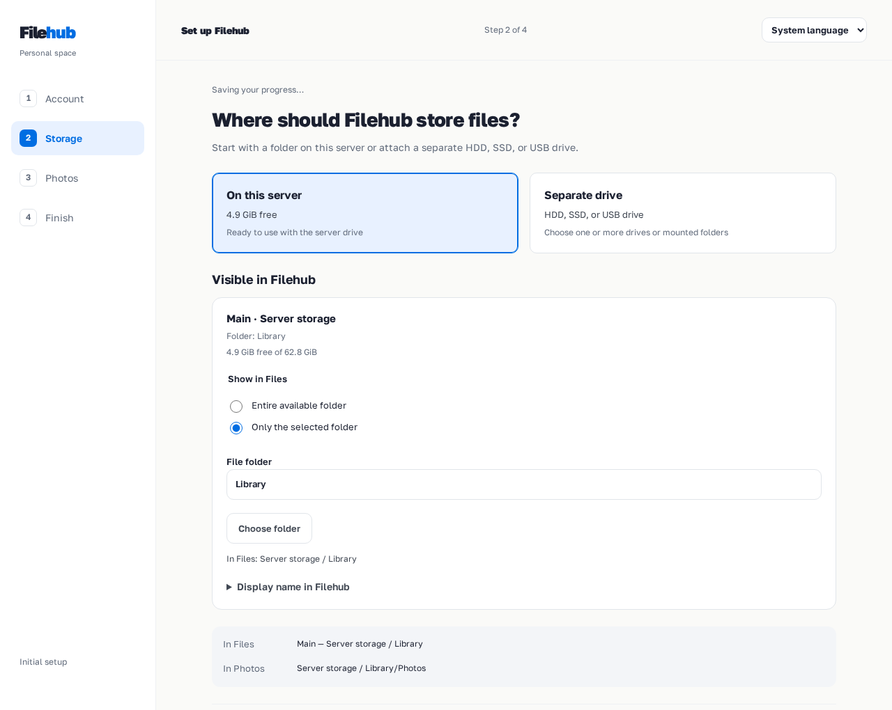
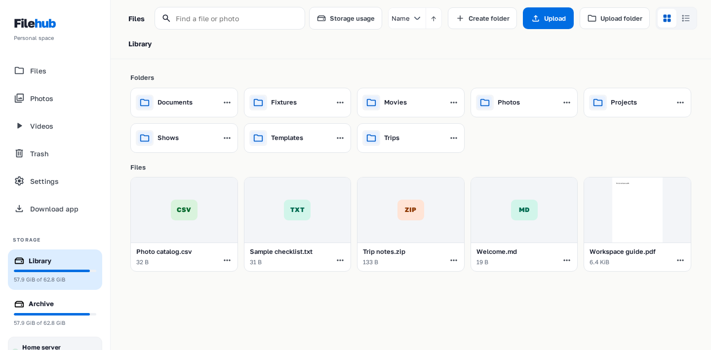
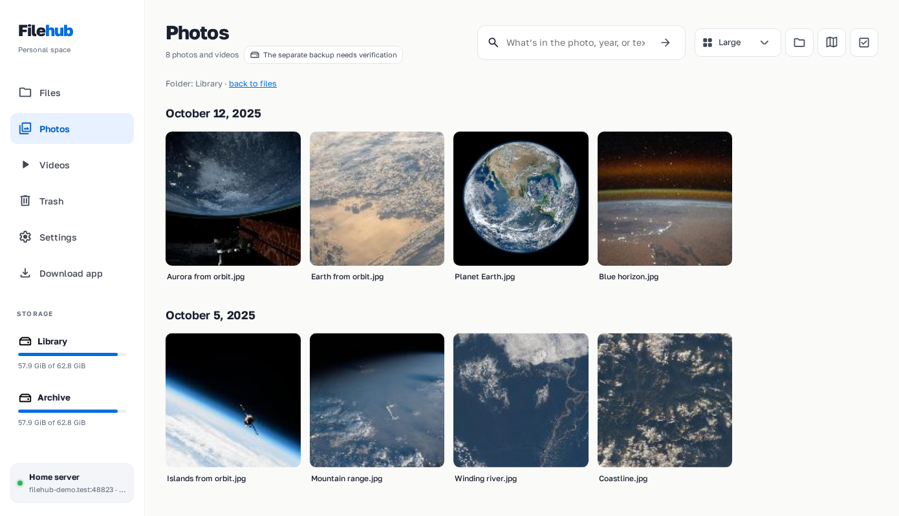
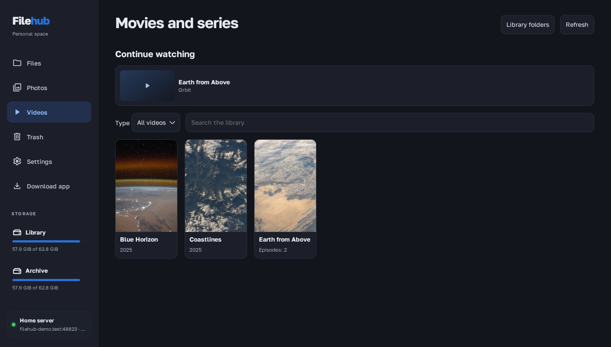
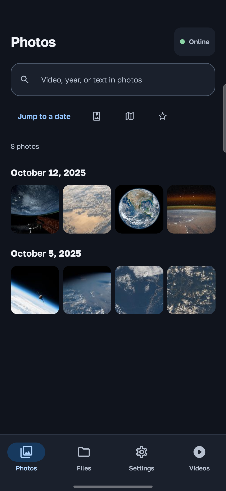
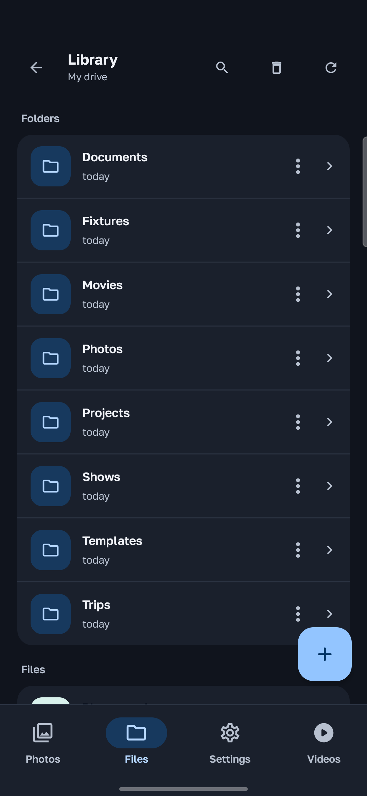
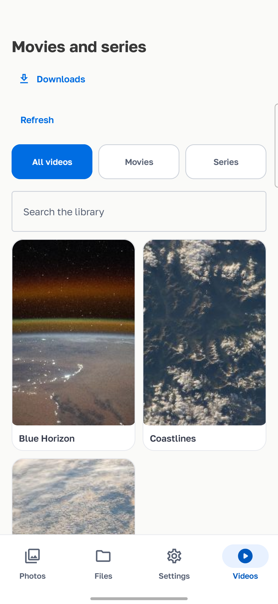

# FileHub FAQ

[Русский](faq.ru.md) · [Installation](installation.md) · [Storage](storage.md) ·
[Upgrades](upgrading.md) · [Screenshot credits](screenshot-credits.md)

- [Getting started and storage](#getting-started-and-storage)
- [Files and search](#files-and-search)
- [Photos and albums](#photos-and-albums)
- [Movies and series](#movies-and-series)
- [The Android app](#the-android-app)
- [Accounts, links and WebDAV](#accounts-links-and-webdav)
- [Backups, storage usage and recovery](#backups-storage-usage-and-recovery)

## Getting started and storage

**Where do I install FileHub?**

Install the server on a Linux x86-64 machine with storage for your files. The ready installer bundles the server, web interface, setup wizard and signed Android APK. Follow the [installation guide](installation.md) for Debian or Ubuntu, the Proxmox LXC option, or the [Compose guide](compose.md) for Docker. The [requirements](resources.md) describe which configurations were tested.

**What happens the first time I start it?**

Open the private link from the terminal, create the administrator account, and choose which folders will appear in **Files**. Choose one or more photo folders, or skip that step and finish setup. The wizard saves your progress. After setup the web and Android app use the same server address and accounts.

**Can I use disks and folders I already have?**

Yes. FileHub can show an entire available location or a folder inside it. Pick one or more attached disks in the wizard, or start with a regular server folder. The optional physical-disk setup mounts eligible existing filesystems. In a container, the host must make the locations available to it. Add more locations later through **Phone and storage → Storage**. Photo folders can be inside any of the selected locations. See [storage setup](storage.md).

**What can I use from a phone or a computer?**

Use the web interface on a desktop, tablet or phone, including Safari on iPhone. Android also has a [native app](#the-android-app). The web interface and Android app support English, Russian, and a system-language option. Both have light and dark themes. Connect over a trusted home network or private VPN. The Android app accepts an explicit HTTP address for a local server, including its port.

## Files and search

**How do I browse and organize files?**

Open **Files** and pick a storage location. Switch between a sortable list and a grid of previews. **Recent** shows recently modified files, while the folder breadcrumb lets you jump back to a parent. The item menu offers actions such as rename, move, copy, download and trash, according to your access. Select several items for a batch action.

**Can I upload a folder or pause a long upload?**

Use **Upload** for files or **Upload folder** for a directory tree. Compatible desktop browsers also support drag and drop, copying and pasting files within FileHub, and dropping local files into a folder. The upload queue shows progress and offers pause, resume and retry. After reloading the page, select the same local file in the same destination to resume if the server still has the partial upload. Folder selection preserves file paths. To bring over empty folders, drag the folder tree in a browser that supports it. [Upload details](maps-and-media.md).

**What can I search for and preview?**

File search matches part of a filename using the server index. You can narrow by extension, type, storage location, size or modification date. Use **Photos** to search by date or text detected in images. Web previews cover supported images, video and PDF, as well as supported Office documents when LibreOffice is set up on the server. Previews are for reading. Download the original to edit it in another app. [Optional preview tools](installation.md#предпросмотр-документов-и-libvips).

**Can I restore something I deleted?**

In the web interface, open **Trash** and select the items you want to restore or permanently delete. Check the original path before restoring. You can select several entries or empty the trash when you are ready to free that space. Permanently deleted items require an independent backup for recovery.

## Photos and albums

**How do photos reach the timeline?**

Select existing photo folders on the server, upload to one of those folders, or configure Android camera backup. The timeline groups photos by date and reads the original files from the selected folders. Open a photo to zoom, swipe to the next one, see its details or download the original. On desktop, the photo grid size can be adjusted.

**What can I do with selected photos?**

Use the selection control or the item menu to work with several images. Where your account has access, you can download them, move them, add them to an album or send them to the trash. Albums group photos without making a copy of each original. Use favorites to keep a short list and browse stories from the photo collection. Photos and albums can also be shared by link.

**Can I find a picture by text, subject or location?**

OCR indexes readable text in photos and screenshots on the server. Newly added files can take time to be indexed. Subject search uses an [optional local visual model](../server/clip-sidecar/README.md) and must be enabled separately. **Places** shows geotagged images from their saved EXIF coordinates. Zoom to a cluster or filter by date. The default map tiles need internet access, while the photos stay on your FileHub server. [Photo and map details](maps-and-media.md).

## Movies and series

**How do I add my media and continue watching on another device?**

An administrator chooses folders under **Videos → Library folders** and assigns them to movies or series. FileHub groups recognized episode files by season. Search the catalog, open a season or choose **Continue watching** to resume the saved position from the same server account. FileHub plays compatible files directly and uses FFmpeg on the server for supported formats that need conversion. Player controls include seeking and playback speed. Android can also select audio and subtitle tracks when available.

**Where do the posters and descriptions come from?**

Choose local poster images and optional NFO descriptions to keep metadata on your server. If you enable TMDB with your own credential in the server settings, FileHub can look up titles and apply posters. Local posters take priority. An administrator can correct an incorrect match. Without a poster, a generated video frame may be available. [Artwork and metadata setup](maps-and-media.md#постеры-фильмов-и-сериалов).

## The Android app

**How do I install the app and connect my phone?**

On Android 8.0 or newer, open your FileHub in the phone's browser and tap **Download app** in the sidebar. Open the signed APK and, if Android asks, allow the browser or file manager you used to install it. Then open FileHub, enter your server address and sign in. [Installation guide](installation.en.md)

**How do I update an installed app?**

FileHub checks your server when you open the app. To check manually, open **Settings**, find the **App** card and tap **Check for updates**. When a newer version appears, tap **Update**. FileHub downloads and verifies the APK, then Android asks you to confirm the update.

If Android first asks for permission, allow FileHub to install apps from this source. Return to FileHub, close the message and check for updates again. A new GitHub release reaches your phone once your server administrator installs the matching release or publishes its signed APK on your server. [Server update guide](upgrading.md)

<table>
<tr>
<td></td>
<td></td>
<td></td>
</tr>
</table>

**Can I save files or a series for offline use?**

Choose **Save offline** from a file or episode menu. Open **Downloads** from **Files** or **Videos** to see the queue and progress, cancel a transfer or retry a failure. Downloads wait for connectivity and retry temporary failures from the beginning. Finished items are available in the same account even when the server is unavailable. Saved videos play in the native player. Saved documents can open in a compatible Android app.

[See the native Downloads screen](images/android-downloads.png).

**How does automatic photo backup work?**

Connect to FileHub over HTTPS. In **Settings**, allow access to photos, select the phone albums, choose the server destination and enable automatic upload. You can set an interval or limit uploads to unmetered networks. The photo backup queue waits for HTTPS, including when you start it from the app. You can continue uploading individual files over home HTTP, including through Android's **Share** menu. Check progress and resumable transfers in backup management.

**What happens when I free space on my phone?**

In the Android cleanup screen, FileHub shows candidates after matching the server receipt and verifying the original with SHA-256. Review the list, select individual items and confirm in Android. Cancel to keep the originals. The verification needs HTTPS or a direct connection to a private IPv4 server on the same trusted local network. Keep a separate backup of anything you plan to remove locally. [Backup and verification details](../SECURITY.md).

## Accounts, links and WebDAV

**How do I give a family member access to just one folder?**

From the web settings, an administrator can invite a user, grant access to selected folders and assign them a writable personal folder. You can set a storage quota for the personal folder. FileHub applies the same permissions to the web, Android and WebDAV. Where the owner is recorded, the file list can show it.

**Can someone share or upload a file without getting a full account?**

Create a share link from a file or album you can share. The recipient needs network access to your FileHub. Set an optional expiry when sharing a file. In a shared album, select **Revoke links** to stop sharing. Administrators can revoke all links to an album. If an older release created the album link, share the album again after updating. Use an upload-only link with an expiration and limits to receive files in a chosen folder.

**Can I connect FileHub as a network drive?**

Yes. In the web interface open **Network drive (WebDAV)** for your server address and connect to the /dav/ endpoint in a WebDAV-capable desktop client. Use your FileHub credentials. The server applies the same folder permissions and quotas as in Files. Use trusted LAN or HTTPS/VPN for the connection.

## Backups, storage usage and recovery

**What is the difference between phone backup and server backup?**

Android backup uploads phone media into a server folder. **Settings → Backup** in the web interface schedules copies of selected server folders and the FileHub index to a separate destination. Choose the folders, destination, days and time, then run a manual backup to verify the configuration. The scheduled job is off by default, needs Python 3 and rsync, and includes a manifest describing the snapshot. Store a copy on a separate disk and test recovery. [Server backup setup](installation.md#резервное-копирование).

**How can I see what is using storage?**

Use **Storage usage** in the web file manager to review usage, large folders and duplicate files. FileHub also shows the space used and available in each storage location. Review duplicates before removing them. If a disk appears offline, reconnect or mount it and check the configured path. [Storage troubleshooting](storage.md).

**How do I update or report a problem?**

Back up the program state and files you need to recover, then follow the [upgrade guide](upgrading.md) for your installation type. For a normal bug report, include the FileHub server and app versions, platform, and steps to reproduce with sample data. Report sensitive issues through the [security reporting instructions](../SECURITY.md).
