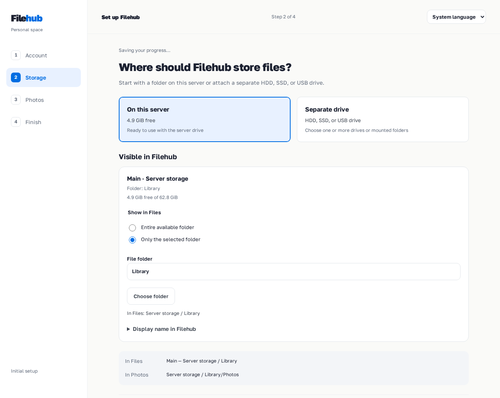
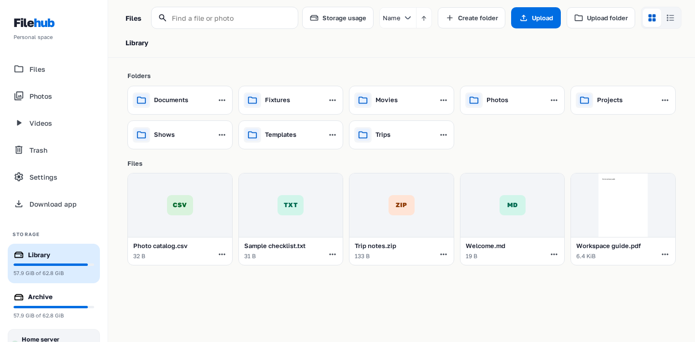
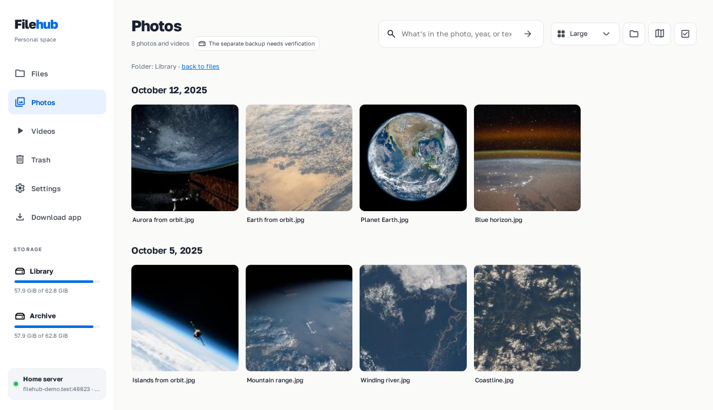
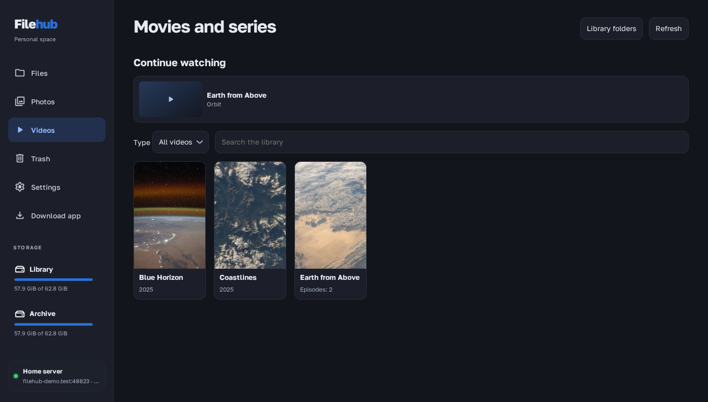
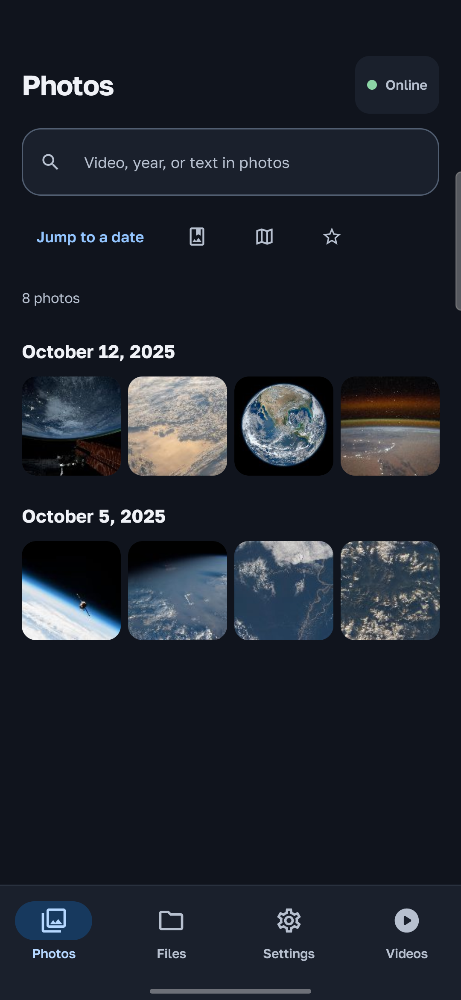
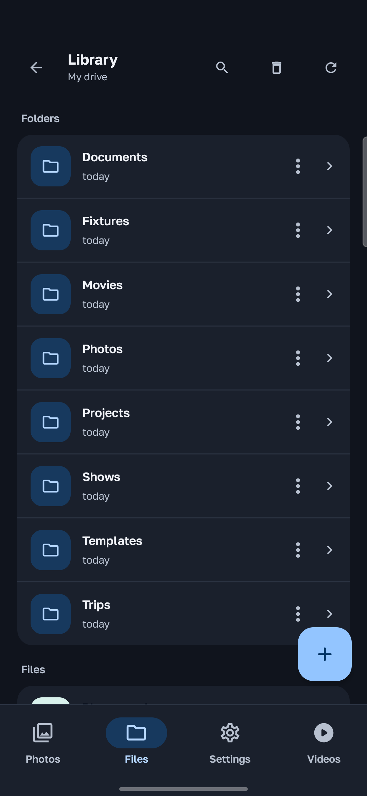
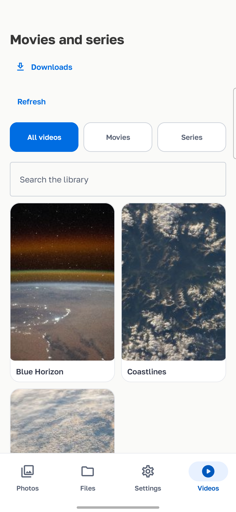

# FileHub — часто задаваемые вопросы

[English](faq.md) · [Установка](installation.md) · [Диски и папки](storage.md) ·
[Обновление](upgrading.md) · [Источники изображений](screenshot-credits.md)

- [Первый запуск и диски](#первый-запуск-и-диски)
- [Файлы и поиск](#файлы-и-поиск)
- [Фотографии и альбомы](#фотографии-и-альбомы)
- [Фильмы и сериалы](#фильмы-и-сериалы)
- [Приложение Android](#приложение-android)
- [Аккаунты, ссылки и WebDAV](#аккаунты-ссылки-и-webdav)
- [Резервные копии, место и восстановление](#резервные-копии-место-и-восстановление)

## Первый запуск и диски

**Куда устанавливать FileHub?**

Установите сервер на компьютер с Linux x86-64 и диском для файлов. В готовом архиве есть сервер, веб-интерфейс, мастер настройки и подписанный APK для Android. В [инструкции по установке](installation.md) описаны Debian, Ubuntu и Proxmox LXC. Для Docker есть [руководство по Compose](compose.md). Проверенные конфигурации перечислены в [требованиях](resources.md).

**Что делать при первом запуске?**

Откройте приватную ссылку из терминала, создайте аккаунт администратора и выберите папки для раздела **Файлы**. Укажите одну или несколько папок с фото либо пропустите этот шаг. Мастер сохраняет прогресс. После настройки веб-версия и Android используют один адрес сервера и те же аккаунты.

**Можно подключить свои диски с существующими файлами?**

Можно. Выберите доступное хранилище целиком или только нужную папку. В мастере можно отметить несколько подключённых дисков либо начать с обычной папки на сервере. Подключение физического диска работает с уже существующей файловой системой. Для контейнера сначала предоставьте нужные папки или диски с хоста. Позже их можно добавить через **Телефон и хранилища → Хранилища**. Папки фотоленты могут находиться в любом подключённом хранилище. [Как устроены хранилища](storage.md).

**Как открыть FileHub с телефона и компьютера?**

Веб-версия работает в браузере компьютера, планшета или телефона, в том числе Safari на iPhone. Для Android есть [нативное приложение](#приложение-android). В вебе и Android можно выбрать русский, английский или язык системы, а также светлую или тёмную тему. Подключайтесь внутри доверенной домашней сети или через личный VPN. Для локального сервера Android принимает полный HTTP-адрес с портом.

## Файлы и поиск

**Как работать с файлами?**

Откройте **Файлы** и выберите хранилище. Переключайтесь между сортируемым списком и сеткой с предпросмотрами. В разделе **Недавние** видны недавно изменённые файлы. По хлебным крошкам можно вернуться в родительскую папку. В меню файла доступны переименование, скачивание, копирование, перенос и отправка в корзину в пределах прав аккаунта. Несколько элементов можно обработать разом.

**Как загрузить папку и продолжить прерванную загрузку?**

Кнопка **Загрузить** принимает файлы, а **Загрузить папку** сохраняет дерево папок. В поддерживаемых браузерах можно перетаскивать файлы и использовать буфер обмена для копирования внутри FileHub. В очереди видны ход загрузок, пауза, продолжение и повтор. После перезапуска страницы выберите тот же файл в той же папке. Если на сервере сохранилась часть передачи, загрузка продолжится с этого места. Чтобы перенести пустые папки, перетащите всё дерево в браузер, который поддерживает такой ввод. [Как работают загрузки](maps-and-media.md).

**По каким данным работает поиск и что можно посмотреть без скачивания?**

Поиск файлов использует индекс и ищет по части имени. Результаты можно сузить по расширению, типу, хранилищу, размеру и дате изменения. В **Фото** можно искать по дате или по тексту, распознанному на снимке. Веб открывает предпросмотр поддерживаемых фото, видео, PDF и документов Office. Для Office на сервере требуется LibreOffice. Предпросмотр работает в режиме чтения. Чтобы отредактировать документ, скачайте оригинал. [Инструменты предпросмотра](installation.md#предпросмотр-документов-и-libvips).

**Можно восстановить удалённое?**

Да. Откройте **Корзину** в веб-версии и выберите файлы для восстановления или окончательного удаления. Перед восстановлением проверьте исходный путь. Можно выбрать несколько записей или очистить всю корзину. Для восстановления после окончательного удаления нужна отдельная резервная копия.

## Фотографии и альбомы

**Что попадает в фотоленту?**

Снимки из выбранных папок на сервере. Можно добавить уже существующую папку, загрузить туда файлы через веб или настроить резервное копирование с Android. Лента группирует фото по датам, а оригиналы остаются в своих папках. В просмотре можно увеличивать фото, листать их, смотреть сведения и скачивать оригиналы. На компьютере можно изменить размер плиток.

**Что можно сделать с несколькими снимками?**

Включите режим выбора или откройте меню снимка. С учётом прав доступа фото можно скачать, перенести в папку, добавить в альбом или отправить в корзину. Альбом объединяет снимки без дублирования оригиналов. Избранное помогает быстро возвращаться к отдельным фотографиям, а истории собраны из фототеки. Фото и альбомами можно делиться по ссылке.

**Как найти фото по тексту, содержимому или месту?**

OCR распознаёт надписи и текст на скриншотах. Новые фото появляются в поиске после фоновой обработки. Поиск по содержимому изображения требует [опциональной локальной модели](../server/clip-sidecar/README.md), которую нужно включить отдельно. На карте в разделе **Места** отображаются фото с координатами в EXIF. Можно приблизить область или выбрать период. Для стандартной картографической подложки нужен интернет, оригиналы снимков хранятся на вашем FileHub. [Карта и фотолента](maps-and-media.md).

## Фильмы и сериалы

**Как собрать медиатеку и продолжить просмотр с другого устройства?**

Администратор выбирает папки через **Видео → Папки медиатеки** и указывает, где фильмы, а где сериалы. FileHub группирует распознанные серии по сезонам. Фильм можно найти в каталоге, а эпизод выбрать в нужном сезоне. Через **Продолжить просмотр** можно вернуться к сохранённому месту под тем же аккаунтом в вебе или Android. Совместимые файлы воспроизводятся напрямую, для других поддерживаемых форматов может использоваться FFmpeg на сервере. В плеере есть перемотка и настройка скорости. Android даёт выбрать дорожку и субтитры, когда они доступны.

**Откуда берутся постеры и описания?**

FileHub может использовать локальные постеры и описания в NFO. В настройках сервера администратор может подключить TMDB с собственным ключом. FileHub подбирает постер по названию и году, а неверное совпадение можно уточнить вручную. Локальный постер имеет приоритет. При отсутствии обложки может показываться кадр из видео. [Настройка постеров и TMDB](maps-and-media.md#постеры-фильмов-и-сериалов).

## Приложение Android

**Как установить приложение и подключить телефон?**

На телефоне с Android 8.0 или новее откройте свой FileHub в браузере и нажмите **Скачать приложение** в боковом меню. Откройте подписанный APK. Если Android запросит разрешение, разрешите установку тому браузеру или файловому менеджеру, из которого открыли файл. Затем откройте FileHub, введите адрес сервера и войдите в свой аккаунт. [Инструкция по установке](installation.md)

**Как обновить уже установленное приложение?**

При запуске FileHub проверяет обновления на вашем сервере. Для ручной проверки откройте **Настройки**, найдите раздел **Приложение** и нажмите **Проверить обновление**. Если появилась новая версия, нажмите **Обновить**. FileHub скачает и проверит APK, затем Android попросит подтвердить обновление.

Если Android сначала запросит разрешение, разрешите установку из этого источника для FileHub. Вернитесь в приложение, закройте сообщение и снова проверьте обновление. Новая версия с GitHub станет доступна на телефоне, когда администратор установит соответствующий выпуск на сервер или разместит на нём подписанный APK. [Инструкция для администратора](upgrading.md)

<table>
<tr>
<td></td>
<td></td>
<td></td>
</tr>
</table>

**Как скачать файл или серию для просмотра без сети?**

Выберите **Сохранить офлайн** в меню файла или эпизода. В разделе **Загрузки** из **Файлов** или **Видео** можно посмотреть очередь и прогресс, отменить или повторить передачу. При временном сбое приложение дождётся подключения и скачает файл повторно с начала. Готовую копию можно открыть офлайн под тем же аккаунтом. Видео воспроизводится в плеере FileHub, документы можно открыть в подходящем приложении Android.

[Скриншот раздела «Загрузки» на Android](images/android-downloads.png).

**Как настроить автоматическую загрузку фото?**

Подключите FileHub по HTTPS. В **Настройках** разрешите доступ к фото, выберите альбомы и папку назначения, затем включите автозагрузку. Можно указать период или выбрать загрузку в сетях без лимита трафика. Очередь фото ждёт HTTPS и при запуске из приложения. По домашнему HTTP можно вручную загружать отдельные файлы, в том числе через меню Android **Поделиться**. Ход загрузки и докачку видно в управлении бэкапом.

**Как освободить место на телефоне?**

FileHub предлагает снимки для очистки после проверки квитанции и сверки SHA-256 с оригиналом на сервере. Просмотрите список, отметьте нужные элементы и подтвердите удаление в Android. При отмене оригиналы сохраняются. Для проверки нужен HTTPS или прямое соединение с приватным IPv4-адресом сервера в той же доверенной сети. Храните отдельную копию оригиналов, которые планируете удалить с телефона. [Условия проверки](../SECURITY.md).

## Аккаунты, ссылки и WebDAV

**Как открыть другому человеку только одну папку?**

Администратор приглашает пользователя через веб-настройки и выдаёт доступ к нужным папкам. Пользователю можно назначить личную папку для записи и квоту. Эти права действуют в вебе, Android и WebDAV. Если владелец файла записан в FileHub, его можно увидеть в списке.

**Как передать файл или принять загрузку без отдельного аккаунта?**

Создайте ссылку на файл или альбом, которыми можно делиться. Получателю нужен сетевой доступ к вашему FileHub. Для ссылки на файл можно задать срок действия. В общем альбоме используйте **Отозвать ссылки**, чтобы закрыть доступ. Администратор может отозвать все ссылки на альбом. Если ссылка создана в старой версии, поделитесь альбомом заново после обновления. Для приёма файлов создайте ссылку для загрузки, выберите папку, срок действия и ограничения.

**Можно подключить FileHub как сетевой диск?**

Да. В вебе откройте **Сетевой диск (WebDAV)** и возьмите адрес с путём /dav/. Подключитесь под своим аккаунтом в клиенте WebDAV. Доступ к папкам и квоты проверяются на сервере. Используйте доверенную домашнюю сеть, HTTPS или VPN.

## Резервные копии, место и восстановление

**Чем резервная копия сервера отличается от резервного копирования телефона?**

Android загружает фото с телефона в выбранную папку сервера. Через **Настройки → Резервное копирование** в вебе можно настроить копирование папок сервера и базы FileHub в отдельное хранилище. Выберите папки, место для копий, дни и время. Перед включением расписания проверьте ручной запуск. По умолчанию расписание выключено. Для работы нужны Python 3 и rsync, готовый снимок содержит манифест. Храните копию на отдельном диске и проверьте восстановление. [Настройка резервных копий сервера](installation.md#резервное-копирование).

**Где посмотреть, чем занято место?**

В веб-разделе **Файлы** откройте **Расход места**. Там можно посмотреть использование хранилища, крупные папки и точные дубликаты файлов. В списке хранилищ видны занятое и свободное место. Проверяйте дубликаты перед удалением. Если диск недоступен, переподключите его и проверьте путь в настройках хранилища. [Диски и папки](storage.md).

**Как обновить сервер или сообщить об ошибке?**

Проверьте резервные копии и следуйте [инструкции обновления](upgrading.md) для своего способа установки. В сообщении об обычной ошибке укажите версии сервера и приложения, платформу и шаги на тестовых файлах. Для сообщений об уязвимостях используйте [закрытый канал из SECURITY.md](../SECURITY.md).
